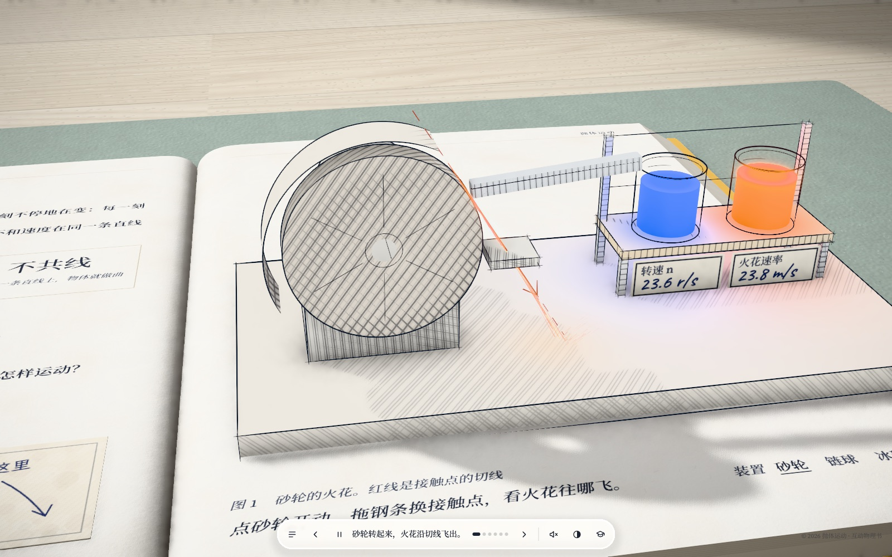
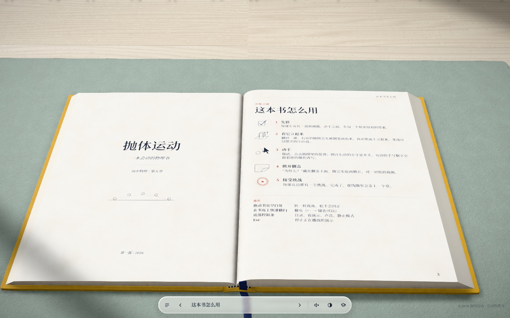
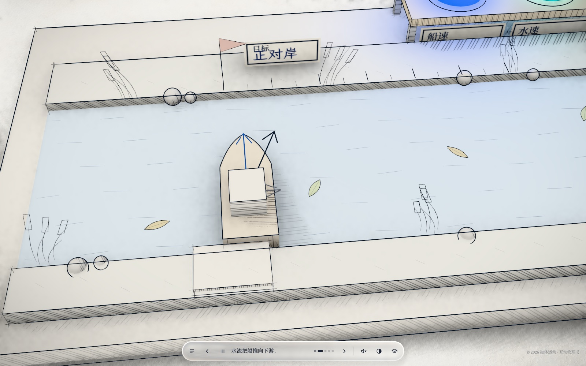
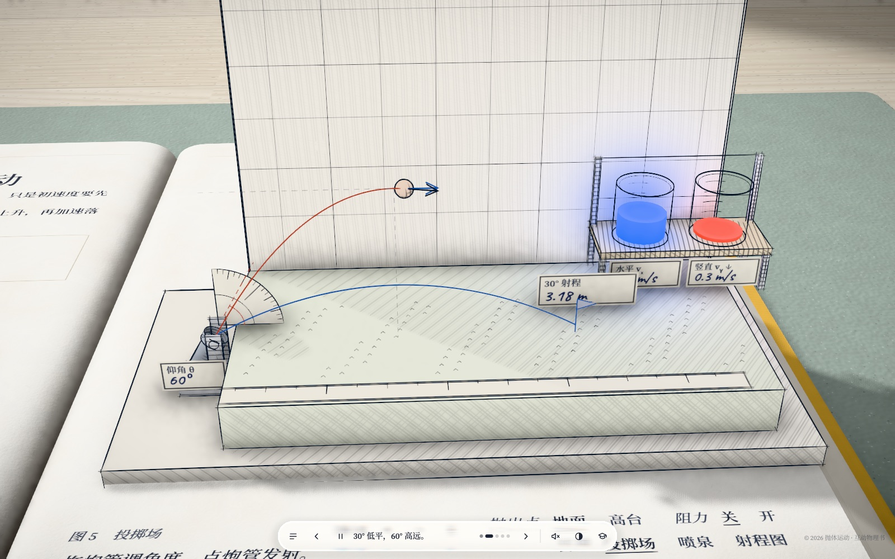

<div align="center">

# 📖 The Moving Physics Book — Every Page Stands Up

**A pop-up physics textbook in your browser. Drag the cannon, tip the boat, watch the numbers.**

English · [简体中文](README.zh-CN.md)

   



</div>

## What is it?

A hands-on 3D book for high-school physics (Chinese curriculum, **Compulsory Book 2, Chapter 5: Projectile Motion**). The left page explains; the right page **pops up a diorama** drawn in ink lines — you pick it up and play: fling a hammer, steer a boat across a river, fire a cannon and plot the range.

Every lesson follows *predict → experiment → explain*, with prediction cards, flip-up answer flaps, margin handwriting, completion stamps, a hover magnifier for fine print, and an original 10-question quiz.

All content, text and illustrations are **original**. The look and page layout are inspired by the browser game *Every Joule*; no code, text or artwork from it is used.

<table>
<tr>
<td></td>
<td></td>
</tr>
<tr>
<td align="center">Front matter & contents</td>
<td align="center">Lesson 2 — boats and bubble-tube cart</td>
</tr>
<tr>
<td colspan="2"></td>
</tr>
<tr>
<td colspan="2" align="center">Lesson 5 — thrower, fountain and range chart</td>
</tr>
</table>

## Contents

| # | Lesson | Apparatus (switchable) |
|---|---|---|
| 1 | Curvilinear motion | grinding wheel sparks · hammer throw · ice-hockey rink |
| 2 | Composition & decomposition of motion | boat crossing a river · bubble-tube cart |
| 3 | Experiment: features of horizontal projectile motion | simultaneous-drop device (overview & close-up) with strobe |
| 4 | Laws of horizontal projectile motion | launch pad · inclined-plane horizontal throw |
| 5 | General projectile motion | thrower with protractor · fountain · draggable range chart |
| + | Front/back matter | how-to, notation, linked contents with stamps, index, formula sheet, 10-question quiz, sources |

Reading aids: spread navigation (`#1`–`#10`), auto-demo with captions, still mode, hover magnifier + tooltips, 19 CC0 sound effects (credits in [`public/audio/README.md`](public/audio/README.md)).

## Progress

| Area | State |
|---|---|
| Rendering base (ink strokes, bound-book model with page curl, post-processing, Retina-correct) | ✅ |
| Five lessons with multi-exhibit dioramas, instrument racks, readout cups | ✅ |
| Hover magnifier, tooltips, prediction cards, stamps, quiz | ✅ |
| Phone portrait layout & page-turn feel | ⬜ planned (phase 3) |
| **Hard-problem visualiser** — AI writes a fixed-format JSON of a problem, our engine *computes* it, checks each number against the official answer, and plays each sub-question | 📝 plan drafted, not built |
| Style skill so any chapter can be generated in the same style | 🧪 trial run: circular motion |
| More chapters | ⬜ |

## Quick start

```sh
npm ci
npm run dev          # http://localhost:5173   — add #3 to jump to spread 3
npm run build
```

Spreads: `#1` front matter · `#2` contents · `#3–#7` lessons 1–5 · `#8` index · `#9` quiz · `#10` sources.
Screenshot tools (headless Chrome) are in `tools/`; see [设计/续做说明.md](设计/续做说明.md).

## Repository

```text
src/engine/   stage (lights, table, AO), post-processing, liquid glass
src/book/     book model, pages, page-turn, cloth cover
src/ink/      ink strokes, paper hatching, pop-up printing, glowing liquid tubes
src/lessons/  lesson runtimes, diorama base class, 5 lessons, projectile model
src/content/  typesetting, lesson text, spreads
src/ui/       control bar, tooltips, magnifier
设计/         design teardown, content plans, hard-problem visualiser plan (Chinese)
research/     competitor & AI-visualisation research (Chinese)
```

## Credits & license

Fonts: Source Serif 4, Noto Serif SC, Caveat, LXGW WenKai (open licences). Sounds: CC0 from Freesound. Libraries: Three.js, postprocessing, N8AO, KaTeX.
Code & original content: [MIT](LICENSE) © 2026 Zeran Wang.
