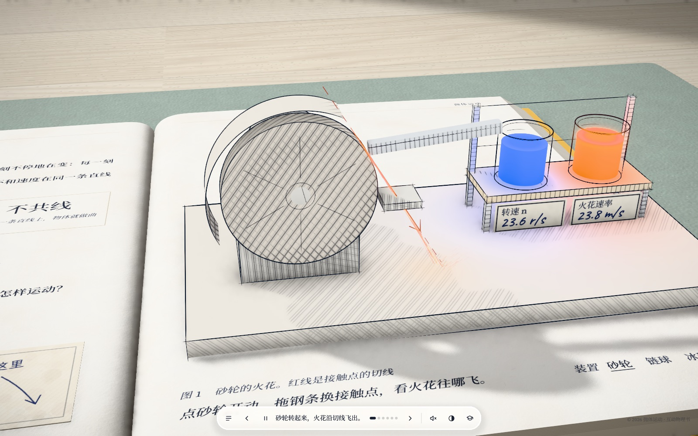
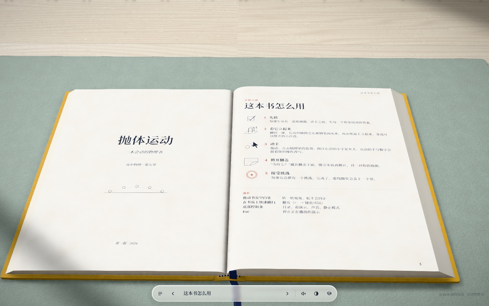
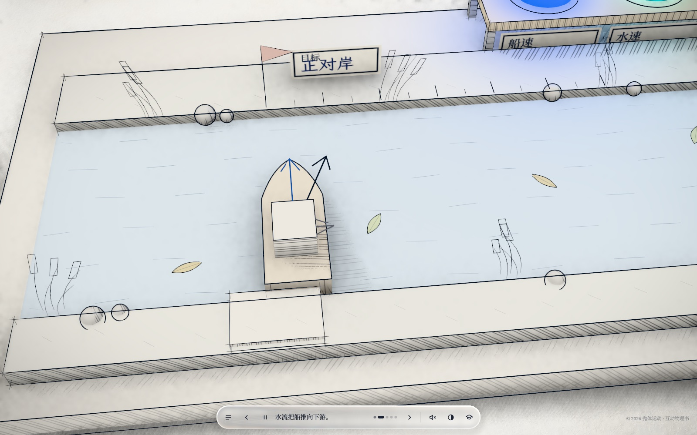
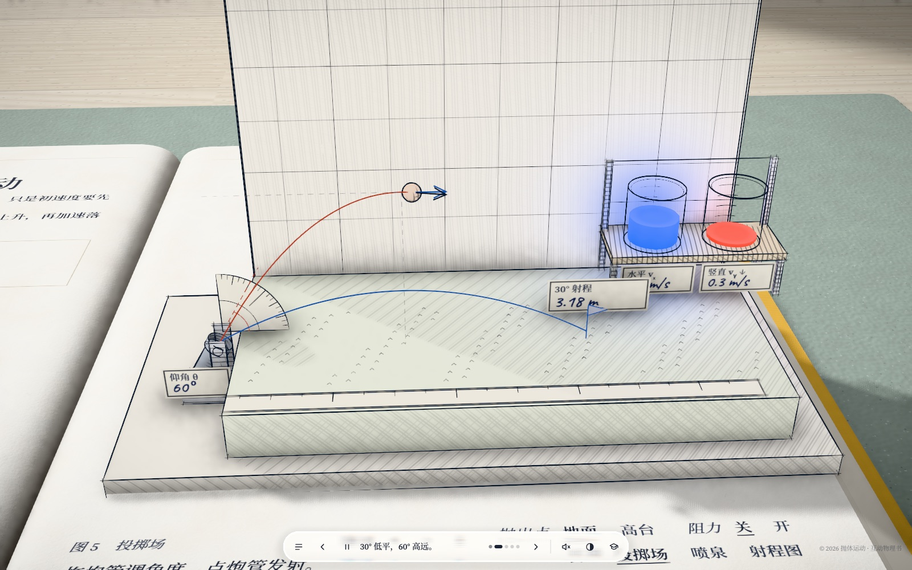

<div align="center">

# 📖 会动的物理书 · 每一页都立得起来

**浏览器里的立体弹出式物理教材。拖动炮管、摇动小船，看着读数变化。**

[English](README.md) · 简体中文

   



</div>

## 这是什么

一本可以动手玩的 3D 高中物理书（人教版**必修第二册 · 第五章 抛体运动**）。左页讲道理，右页**立起一个墨线画成的装置**，你可以亲手摆弄：抛出链球、驾船过河、发射炮弹并记录射程。

每一课都遵循"先预测 → 再实验 → 后解释"：预测卡、翻盖答案、页边手写、通关印章、鼠标划过的放大镜（看小字）、原创的 10 道测验。

全部文字、插图和内容均为**原创**。外观与版式受浏览器游戏 *Every Joule* 启发，没有使用它的任何代码、文字或图形。

<table>
<tr>
<td></td>
<td></td>
</tr>
<tr>
<td align="center">前言与目录</td>
<td align="center">第 2 课：小船与气泡管小车</td>
</tr>
<tr>
<td colspan="2"></td>
</tr>
<tr>
<td colspan="2" align="center">第 5 课：投掷场、喷泉与射程图</td>
</tr>
</table>

## 内容

| # | 课 | 装置（可切换） |
|---|---|---|
| 1 | 曲线运动 | 砂轮火花 · 链球 · 冰球场 |
| 2 | 运动的合成与分解 | 小船过河 · 气泡管小车 |
| 3 | 实验：探究平抛运动的特点 | 同时下落仪（全景与特写）、频闪灯 |
| 4 | 平抛运动的规律 | 抛射台 · 斜面平抛 |
| 5 | 一般的抛体运动 | 带量角器的投掷场 · 喷泉 · 可拖动的射程图 |
| + | 前后附页 | 用法、记号、可点目录与印章、索引、公式一览、10 道测验、来源 |

阅读辅助：跨页跳转（`#1`–`#10`）、带字幕的自动演示、静止模式、放大镜与提示卡、19 段 CC0 音效（出处见 [`public/audio/README.md`](public/audio/README.md)）。

## 目前进度

| 模块 | 状态 |
|---|---|
| 渲染底座（墨线、有厚度的书本与翻页卷角、后期、高分屏正确） | ✅ |
| 五课多装置沙盘、仪表架与读数杯 | ✅ |
| 放大镜、提示卡、预测卡、印章、测验 | ✅ |
| 手机竖屏与翻书手感 | ⬜ 计划放到第三部分 |
| **难题可视化**：学生把难题交给自己的 AI，AI 按固定格式写出 JSON，我们的引擎自己**把题算一遍**、逐个核对答案，再按小问播放动画 | 📝 已有计划书，未开发 |
| 风格 skill：让任何一章都能按同样风格生成 | 🧪 已试跑（圆周运动） |
| 更多章节 | ⬜ |

## 快速开始

```sh
npm ci
npm run dev          # http://localhost:5173 ，加 #3 直接翻到第 3 个跨页
npm run build
```

跨页编号：`#1` 前言 · `#2` 目录 · `#3–#7` 第 1–5 课 · `#8` 索引 · `#9` 测验 · `#10` 来源。
截图工具（无头 Chrome）在 `tools/`，用法见 [设计/续做说明.md](设计/续做说明.md)。

## 目录

```text
src/engine/   舞台（灯光、桌面、环境遮蔽）、后期、液态玻璃
src/book/     书本模型、页面、翻页、布面封面
src/ink/      墨线笔画、纸面排线、立体印刷、发光液体管
src/lessons/  各课运行时、沙盘基类、五课装置、抛体模型
src/content/  排版、课文、跨页
src/ui/       控制条、提示、放大镜
设计/         设计拆解、内容方案、难题可视化计划书
research/     竞品与 AI 可视化调研
```

## 致谢与许可证

字体：Source Serif 4、思源宋体、Caveat、霞鹜文楷（开源许可）。音效：Freesound CC0。依赖：Three.js、postprocessing、N8AO、KaTeX。
代码与原创内容：[MIT](LICENSE) © 2026 Zeran Wang。
